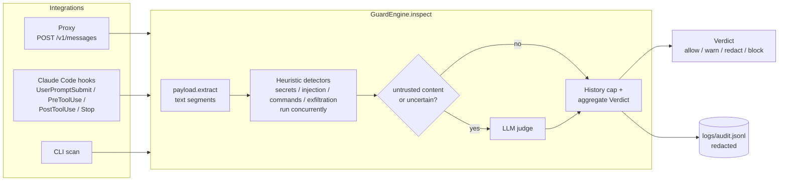

# Architecture

claude-guard has one inspection engine used by two integrations: an Anthropic-compatible API
proxy and Claude Code hooks.



## Modules

| Module | Responsibility |
|--------|----------------|
| `models.py` | `Severity`, `Action`, `Direction`, `Category`, `TextSegment`, `InspectionContext`, `Finding`, `Verdict` (immutable pydantic models) |
| `config.py` | `Settings` (env `GUARD_*`, `.env`), `Policy` models, `load_policy()` |
| `payload.py` | Extracts text segments from payloads and writes redactions back by location |
| `engine.py` | `GuardEngine`: runs detectors, judge, history cap, fail mode, audit |
| `detectors/` | `secrets`, `injection`, `commands`, `exfiltration` (heuristics), `custom` (`custom_rules` from the policy) and `llm_judge` |
| `detectors/obfuscation.py` | Shared normalization (invisible characters, homoglyphs, leetspeak, spacing) and base64/hex/percent decoding |
| `audit.py` | Appends one redacted JSON line per inspection |
| `proxy/` | FastAPI proxy (`/v1/messages`, `count_tokens`, Message Batches, `/healthz`, `/metrics`, passthrough policy), SSE streaming modes, listen/TLS options for `serve` (`server.py`) |
| `hooks/` | Claude Code hook event handlers |
| `cli.py` | Typer CLI: `serve`, `scan`, `hook`, `install-hooks`, `report` |

## Payloads and directions

| Direction | Payload | Notes |
|-----------|---------|-------|
| `request` | Messages API request body | system, tool descriptions, all messages |
| `response` | Messages API response | assistant text and `tool_use` blocks |
| `tool_input` | `{"tool_name", "tool_input"}` | a tool call about to run (PreToolUse) |
| `tool_output` | `{"tool_name", "tool_response"}` | a tool result (PostToolUse), untrusted |

`payload.extract` turns a payload into `TextSegment`s. Each segment has:

- `location`: path into the payload, e.g. `messages[2].content[0].text`. Keys that are not
  plain identifiers are JSON-quoted (`tool_response["a.b"]`).
- `role`: `system`, `tool_definition` (operator roles), `user`, `assistant` or `tool`.
- `trusted`: `false` for tool results, documents, server tool results and hook tool output.
- `tool_name` / `tool_field`: set for strings inside a tool call input, e.g. `Bash` / `command`.

Content block handling:

| Block | Handling |
|-------|----------|
| `text` | inspected with the message role |
| `tool_use`, `server_tool_use` | every string in `input` becomes a tool segment |
| `tool_result` | string or nested blocks, untrusted |
| `document` with text/content source | untrusted |
| `image`, base64/URL `document`, `thinking`, `redacted_thinking` | skipped, recorded in `Verdict.notes` |
| other blocks (web search/fetch results, search results, unknown) | every prose string, untrusted; identifiers, signatures and encrypted content are ignored |

## Engine

1. Extract segments. A malformed payload is an engine error.
2. Run the heuristic detectors concurrently (`asyncio.gather`). A detector exception is recorded
   as an engine error; other detectors' findings are kept.
3. If `llm_judge.enabled` (and the caller allows it, e.g. `GUARD_HOOK_LLM` for hooks) and
   `needs_judgement()` is true, run the judge on the **current turn only**.
4. **History cap** (requests only): findings located in messages before the last assistant
   message are capped at `warn`, except secrets, which keep `redact`. The conversation is resent
   on every request, so without the cap a single old tool result would block the session
   forever; content was inspected when it was new.
5. `Verdict.action` is the strictest finding action. On engine errors the fail mode applies:
   `GUARD_FAIL_MODE=closed` blocks, `open` keeps the action computed from what succeeded.
6. Append an audit record.

`GuardEngine.redact(payload, verdict)` returns a copy of the payload where each `redact`
finding's span is replaced with `[REDACTED:<rule>]`, right to left per string so offsets stay
valid. The original payload is never modified.

## Audit log

`logs/audit.jsonl` (`GUARD_AUDIT_PATH`), one JSON object per inspection:

```json
{"timestamp": "2026-10-05T14:02:11.120Z", "direction": "request", "action": "redact",
 "source": "proxy", "session_id": "…", "duration_ms": 3.41,
 "findings": [{"detector": "secrets", "category": "secrets", "rule": "github_token",
   "severity": "critical", "action": "redact", "confidence": 0.98,
   "message": "GitHub token detected", "location": "messages[0].content[0].text",
   "excerpt": "ghp_Ab3***BcD"}]}
```

Excerpts, messages, errors and notes go through the secret scanner before writing, so secrets
never reach the log, even when quoted next to an injection pattern.

The log is rotated by size: when a record would grow it past `GUARD_AUDIT_MAX_BYTES` (10 MiB),
`audit.jsonl` becomes `audit.jsonl.1`, older copies shift up and only `GUARD_AUDIT_BACKUPS` (5)
are kept. Hooks run as separate processes, so every write and rotation happens under an
exclusive lock on `audit.jsonl.lock` (POSIX `flock`; no lock on Windows). `claude-guard report`
reads the rotated copies too. The log and its copies are protected from the agent
(`guard_tamper`). Write failures are logged
and never interrupt traffic. Hooks run as separate processes, so each record is a single append.
